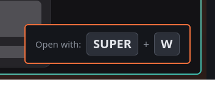

# hyprbsd-keyhint


[](https://buymeacoffee.com/sheridans)

Teaches HyprBSD's key bindings. When you open a program from the launcher, the HyprBSD menu or
a button on the bar, and a key binding starts it too, a card shows those keys for a few seconds
inside the bottom-right corner of the program's window. It isn't a notification: it never takes
your keyboard, clicks go through it, and it closes by itself. Opening the program with its keys
shows nothing.



It follows the window if it moves, and goes when the window closes. With no window of the
program's (a menu, a panel), the card shows in the corner of the monitor you were on. It knows
your own bindings as well as HyprBSD's.

It's part of [HyprBSD](https://hyprbsd.org).

## Install

**On HyprBSD** it's installed with the desktop. The launcher (Super+R, Super+Space), the
HyprBSD menu and the bar use it, and the menu's Toggles, Shortcut hints turns it off.

**On FreeBSD, from source:**

```
pkg install rust pkgconf gtk4 gtk4-layer-shell
make
make install
```

It installs `/usr/local/bin/hyprbsd-keyhint`; `make install PREFIX=/opt/keyhint` puts it
elsewhere, and `DESTDIR` installs into a staging directory. It reads the bindings from
`hyprbsd_shortcuts()`, which HyprBSD's Hyprland config defines, so outside HyprBSD it shows
nothing until your config has that function.

## Usage

- **`hyprbsd-keyhint launch [wofi option ...]`** opens wofi's app list, starts the program you
  pick and shows its keys.
- **`hyprbsd-keyhint show command [arg ...]`** shows the keys of the binding that runs that
  command, for menus and bars that start it themselves. It prints `ready` once it's watching for
  the program's window, so start the command after that.
- **`hyprbsd-keyhint hide`** closes the card.

No card shows while `~/.config/hyprbsd/keyhint-off` exists.

## Building

You need Rust (FreeBSD's `rust` package), pkgconf, GTK 4, gtk4-layer-shell and FreeBSD's make;
`make dist` needs `git` too:

```
make            # target/release/hyprbsd-keyhint
make check      # rustfmt's check, the tests, clippy and the session test
make deny       # cargo-deny: the crates' licences, advisories and sources (deny.toml)
```

[CONTRIBUTING.md](CONTRIBUTING.md) has the tests and how a release is made. Report security
problems privately: see [SECURITY.md](SECURITY.md).

## Licence

BSD-2-Clause; see `LICENSE`.
